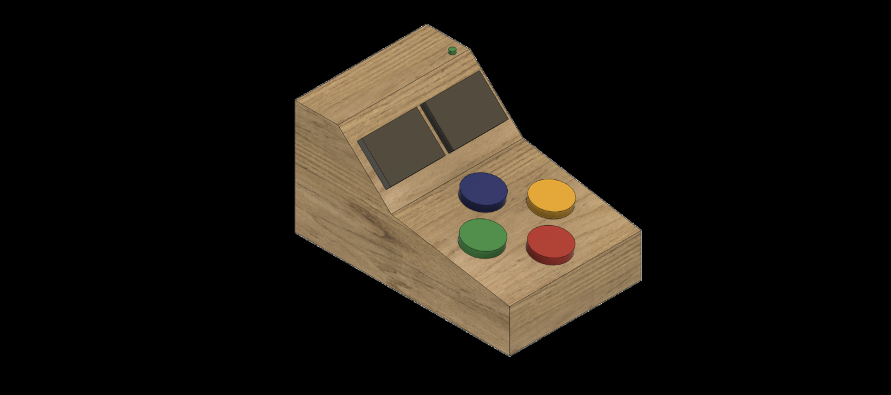
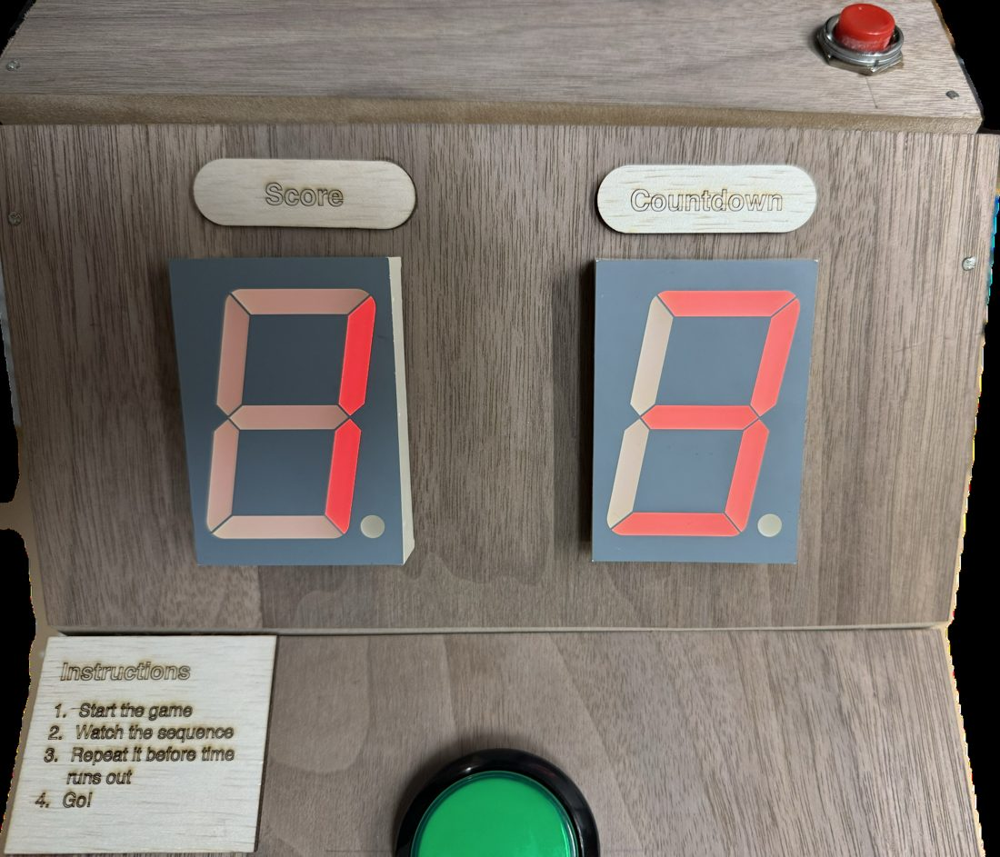
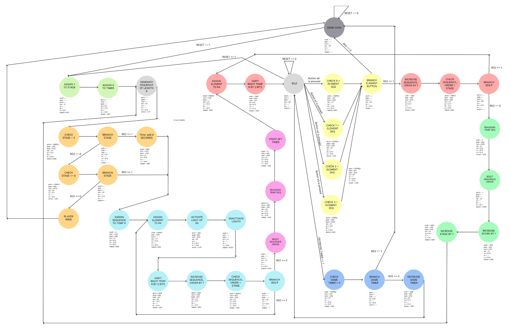
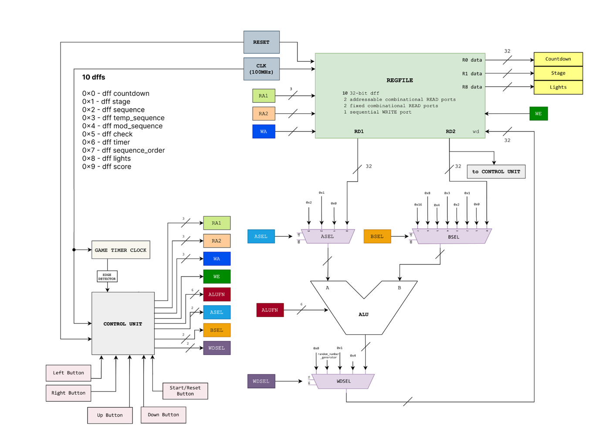

# 👑 Tappin' Queen

> A hardware Simon-style memory game, built from scratch on an **Alchitry Au FPGA**
> with a custom 32-bit ALU, a 41-state control unit, and zero soft-core CPUs.


**SUTD 50.002 Computation Structures · 1D & 2D Project · Team 31 (2025)**

---

## 🎮 The Game

Tappin' Queen is a direction-based memory game inspired by the classic *Simon*.
The machine flashes a colour sequence; you tap it back on the arcade buttons before
the countdown runs out.

Unlike the original Simon, **every round generates a brand-new random sequence**, so
you can't coast on muscle memory from the previous round.

| Round | Sequence length | Timer |
|:--|:--|:--|
| Stage 1 | 1 input | longest |
| Stage 2 | 2 inputs | shorter |
| … | … | … |
| Stage 8 | 8 inputs | shortest |

Each cleared stage lengthens the sequence, tightens the countdown, and raises
your score, which is displayed live on the seven-segment display.

<p align="center">
  
  
</p>
<p align="center"><i>CAD render of the arcade cabinet (left) and the built physical prototype (right)</i></p>

https://github.com/user-attachments/assets/70fbde3a-85fc-4dbe-83ab-5d218d40d0aa

<p align="center"><i>How a round works: one random number, sliced into moves, then played</i></p>

---

## 🏗 How It Works

The entire game is **pure digital logic**, with no microcontroller and no soft CPU.
Everything below is written by hand in Lucid HDL and synthesised onto the Au.

### 32-bit ALU

A full ALU assembled from primitive gates, driving all in-game arithmetic
(score, timer decrement, sequence indexing, colour extraction):

| Unit | Module | Role |
|:--|:--|:--|
| Adder / Subtractor | `adder.luc`, `rca.luc`, `fa.luc` | ripple-carry add & subtract, with Z / V / N flags |
| Multiplier | `multiplier.luc` | score scaling |
| Boolean | `boolean.luc` | bitwise AND / OR / XOR / pass |
| Shifter | `shifter.luc`, `x_bit_left_shifter.luc` | logical & arithmetic shifts |
| Comparator | `compare.luc` | CMPEQ / CMPLT / CMPLE from the adder flags |
| Divider / Mod-4 | `divider.luc`, `modfour.luc` | colour decoding |

Operation select is a 6-bit `ALUFN` signal, with the output chosen through a
tree of `mux_2` / `mux_4` selectors.

### 41-State Control Unit

`game_cu.luc` is a hand-specified FSM of **41 states**, covering start-up, sequence
generation, playback, player input capture, per-input validation, win/lose
resolution, stage advancement and reset. It sequences `game_datapath.luc` and
`game_regfiles.luc` on every clock edge.

<p align="center">
  <br/>
  <i>Control unit state transition diagram</i>
</p>

<p align="center">
  <br/>
  <i>Game datapath: ALU, register files and mux network</i>
</p>

### Randomness on a Budget

RNG is expensive in hardware, so instead of drawing once per colour we
**draw once per round**. A single 16-bit pseudo-random value from an Xorshift
generator (`pn_gen.luc` into `random_number_generator.luc`) is sliced into an
**8-colour sequence at 2 bits per colour** (4 possible colours). One draw,
eight symbols, cutting RNG invocations by 8x.

### Hardware Optimisations

- **Fewer RNG calls.** One 16-bit draw unpacked into the whole round's sequence.
- **Minimal storage.** Register usage kept tight; values recomputed rather than latched wherever cheaper.
- **Mod-4 without a divider.** `a - ((a >> 2) << 2)` extracts the low two bits in pure combinational logic.
- **Button debouncing and edge detection** on every input to reject mechanical bounce.
- **Cross-clock timing fixes.** A slow clock drives gameplay and LED refresh while the 100 MHz system clock drives the datapath; edge detectors bridge the two domains safely.

---

## 📁 Repository Layout

```
source/
├─ alchitry_top.luc            # top level: pin mapping, clocking, I/O
├─ game_cu.luc                 # 41-state control unit (FSM)
├─ game_datapath.luc           # datapath wiring
├─ game_regfiles.luc           # register files
├─ alu.luc                     # 32-bit ALU
│  ├─ adder.luc / rca.luc / fa.luc
│  ├─ multiplier.luc
│  ├─ boolean.luc
│  ├─ shifter.luc / x_bit_left_shifter.luc
│  ├─ compare.luc
│  ├─ divider.luc / modfour.luc
│  └─ mux_2.luc / mux_4.luc / bit_reverse.luc
├─ pn_gen.luc                  # Xorshift PRNG
├─ random_number_generator.luc # seeded RNG wrapper
└─ seven_seg.luc / multi_seven_seg.luc  # score & timer display

constraint/                    # pin constraints
50.002-1D-Project.alp          # Alchitry Labs project file
```

---

## 🔌 Build & Run

1. Open `50.002-1D-Project.alp` in **Alchitry Labs**.
2. Connect an **Alchitry Au** (plus Io shield / custom button board).
3. Build to generate the bitstream, then flash to the FPGA.
4. Press start, and try to keep up. 👑

---

Built for **SUTD 50.002 Computation Structures**, 2025.
Full design write-up, testing methodology and sustainability analysis live in the project report.
